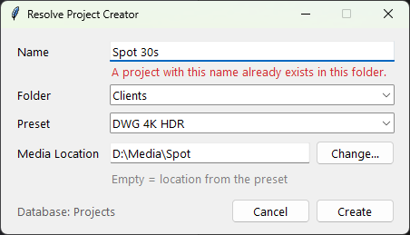

# Resolve Project Creator

DaVinci Resolve's **Create New Project** dialog can't apply a project settings preset.
This little Windows app can: name, folder, preset, media location → **Create**.



## What it does

- Lists your Project Manager folders and your saved **project settings presets**
  (Project Settings → Presets → Save As).
- Checks the name as you type: shows an error if a project with that name already
  exists in the chosen folder (or the name has characters Resolve can't save).
- On **Create**: starts DaVinci Resolve if it isn't running and waits for it, saves the
  project that is currently open, creates the new project in the chosen folder,
  applies the preset, sets the media location, saves and opens it.
- Remembers the last preset, folder and media location.

With a **disk / Project Library** database the lists and the name check are instant and
don't need Resolve running (they are read from the database folder). With a
**PostgreSQL** or **Blackmagic Cloud** database the app starts Resolve right away and
gets the lists through the scripting API.

## Requirements

- Windows 10/11
- **DaVinci Resolve Studio** 19, 20 or 21 (external scripting doesn't work in the free version)
- In Resolve: **Preferences → System → General → External scripting using: Local**

Tested on Resolve Studio 20 with a disk database. Resolve 19/21 and PostgreSQL/Cloud
databases are supported by design but not tested yet — issues welcome.

Media Location needs Resolve 20 or newer. Leave it empty to keep the location stored in the preset.

## Install

Download `ResolveProjectCreator.exe` from [Releases](../../releases) and run it.
Nothing else to install: Python is bundled, Resolve's own scripting library is used.

The exe isn't code-signed, so the first time Windows SmartScreen may say
*"Windows protected your PC"*: click **More info → Run anyway**.

Tip: pin it to the taskbar or Start.

## Notes

- Preset names come from Resolve itself; `System Config` and `<user> default config`
  are Resolve's built-in ones.
- Project names can't contain `< > : " / \ | ? *` — Resolve accepts some of them and then
  fails to save the project, so the app blocks them.
- Settings are stored in `%APPDATA%\ResolveProjectCreator\settings.json`.
- The app never switches databases and never edits Resolve's preferences.

## Run from source

```
python run.py
python tests/test_diskdb.py
```

Build: `pip install pyinstaller` then
`pyinstaller --onefile --windowed --name ResolveProjectCreator --paths src run.py`.
Releases are built by GitHub Actions on a `v*` tag.

## License

MIT
